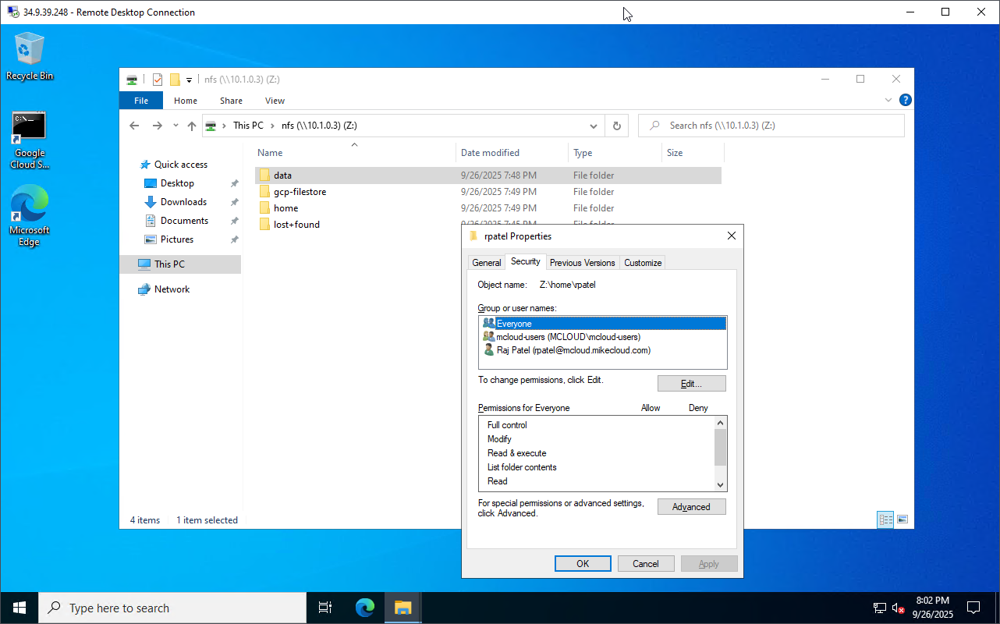

# RStudio Server Cluster on GCP: Managed Instance Group, Filestore and Active Directory

An **RStudio Server** cluster for shared data-science work, built on the
[GCP Mini Active Directory](https://github.com/mamonaco1973/gcp-mini-ad) lab.
A global **HTTP load balancer** spreads users across a **managed instance
group** of RStudio VMs built from a **Packer** image; every VM joins a
**mini-AD** domain, so users sign in with their AD accounts, and mounts the
same **Filestore** share for home directories, shared data and a shared R
package library. A Windows VM and a Samba gateway give admins access to the
same files.


| Piece | Where | Role |
|---|---|---|
| **rstudio-alb** | global | external HTTP load balancer on the static IP `rstudio-lb-ip`, port 80; backend service with generated-cookie affinity for a day; health check `/auth-sign-in` on 8787 |
| **rstudio-instance-group** | regional MIG, `us-central1` | `e2-standard-2` VMs from `rstudio-template`, 2 to 4, scaled at 60% CPU with a 300 s cooldown; named port `http` = 8787 |
| **RStudio image** | built by Packer | Ubuntu 24.04 with R, RStudio Server (open source) and SSSD/realmd; `apply.sh` picks the newest by name |
| **rstudio-nfs-server** | Filestore, `us-central1-a` | BASIC_HDD, 1 TB share `filestore`, mounted over NFSv3 |
| **nfs-gateway-&lt;suffix&gt;** | `us-central1-a` | Ubuntu 24.04, `e2-standard-2`; joined to AD; mounts the share and serves `/nfs` over Samba |
| **win-ad-&lt;suffix&gt;** | `us-central1-a` | Windows Server 2022, `e2-standard-2`; joined to AD; RSAT; maps the gateway's share as `Z:` |
| **mini-AD** | subnet `10.1.0.0/24` | [`module-gcp-mini-ad`](https://github.com/mamonaco1973/module-gcp-mini-ad) Samba DC (`e2-medium`) for `rstudio.mikecloud.com` (`RSTUDIO`); users, groups, POSIX IDs, DNS, Kerberos |
| **Secret Manager** | project | `admin-ad-credentials-rstudio`, one `*-ad-credentials-rstudio` secret per user, and the Windows `sysadmin` password |
| **rstudio-router** / **rstudio-nat** | `us-central1` | Cloud NAT for outbound traffic |

## Architecture

<picture>
  <source media="(prefers-color-scheme: dark)" srcset="architecture-dark.svg">
  
</picture>

Regenerate with `python3 make_diagram.py`. The gateway and Windows VM also
join the domain; those lines are left off the diagram to keep it readable.

- **`01-directory/`**: the VPC, subnet and Cloud NAT, the passwords in
  Secret Manager, and the mini-AD DC with users and groups from
  `scripts/users.json.template`.
- **`02-servers/`**: Filestore, the gateway and Windows VMs, and their
  firewall rules.
- **`03-packer/`**: the RStudio image (`rstudio_image.pkr.hcl` and its
  install scripts).
- **`04-cluster/`**: the instance template, managed instance group and
  autoscaler, and the load balancer (`alb.tf`).
- **`05-rsamples/`**: sample R scripts and `packages.R`.
- **`06-utils/`**: `getNextUID` / `getNextGID` scripts for adding AD users.

## How a VM starts

`rstudio_booter.sh` mounts the share's root as `/nfs` and its `home`
directory as `/home`, creates `/nfs/home`, `/nfs/data` and `/nfs/rlibs`,
reads the AD admin password from Secret Manager, joins the domain with
`realm join` (SSSD with short names and the POSIX IDs from AD), gives
`linux-admins` passwordless sudo, and writes `Rprofile.site` so the library
path is the user's own library, then `/nfs/rlibs`, then the system library.
`/nfs/rlibs` belongs to `rstudio-admins`.

## Users and groups

| User | uidNumber | Groups | Notes |
|---|---|---|---|
| jsmith | 10001 | rstudio-users, us, linux-admins, rstudio-admins, Domain Admins | sudo; writes `/nfs/rlibs` |
| edavis | 10002 | rstudio-users, us | |
| rpatel | 10003 | rstudio-users, india, linux-admins, rstudio-admins, Domain Admins | sudo; writes `/nfs/rlibs` |
| akumar | 10004 | rstudio-users, india | |

| Group | gidNumber |
|---|---|
| rstudio-users | 10001 (every user's primary group) |
| us | 10002 |
| india | 10003 |
| linux-admins | 10004 |
| rstudio-admins | 10005 |

## Prerequisites

* [A Google Cloud Account](https://console.cloud.google.com/)
* [Install gcloud CLI](https://cloud.google.com/sdk/docs/install)
* [Install Terraform](https://developer.hashicorp.com/terraform/install)
* [Install Packer](https://developer.hashicorp.com/packer/install)
* [Install jq](https://jqlang.github.io/jq/download/)

Put a service account key in the repository root as `credentials.json`. If
this is your first time watching our content, we recommend starting with
this video: [GCP + Terraform: Easy Setup](https://youtu.be/3spJpYX4f7I).

## Deploy

```bash
git clone https://github.com/mamonaco1973/gcp-rstudio-cluster.git
cd gcp-rstudio-cluster
./apply.sh
```

`check_env.sh` signs in with `credentials.json` and runs `api_setup.sh` to
enable the APIs. `apply.sh` applies `01-directory` and `02-servers`, builds
the RStudio image with Packer, and applies `04-cluster` with the newest
image. It ends by running `validate.sh`, which waits for the load balancer
to return HTTP 200 on `/auth-sign-in`:

```
============================================================================
RStudio Quick Start - Validation Output (GCP)
============================================================================

NOTE: NFS Gateway Host:      34.x.x.x
NOTE: Windows RDP Host:      34.x.x.x

NOTE: RStudio URL:           http://<lb IP>
```

## Try it

1. Open the **RStudio URL** and sign in as one of the users above, with the
   password from its `*-ad-credentials-rstudio` secret.
2. Open a sample from `05-rsamples`; the gateway clones this repository
   into the share.
3. Add a user:
   1. RDP to the **Windows RDP Host** as `jsmith` or `rpatel` and open
      **Active Directory Users and Computers** with **View > Advanced
      Features** on.
   2. Under the domain's **Users** container, create the user with a UPN
      such as `mcloud@rstudio.mikecloud.com` and an initial password.

      

   3. Run `Z:\gcp-rstudio-cluster\06-utils\getNextUID.bat` for the next
      free `uidNumber`.
   4. In **Attribute Editor**, set `uidNumber` to that value, `gidNumber` to
      `10001`, and `uid` to the login name.
   5. Under **Member Of**, add `rstudio-users` and any other groups.
   6. SSH to the **NFS Gateway Host** and check the mapping with
      `id mcloud`:

      

   7. Sign in to RStudio as the new user. They can't write `/nfs/rlibs`
      until they're in `rstudio-admins`.

## Teardown

```bash
./destroy.sh
```

## Notes

- **Lab only.** RStudio is served over plain HTTP. Firewall rules open SSH
  (22), SMB (445), RDP (3389), NFS (2049) and 8787/80 on the RStudio VMs to
  `0.0.0.0/0`.
- The old README listed `india` as 10002 and `us` as 10003; the template
  sets `us` to 10002 and `india` to 10003.
